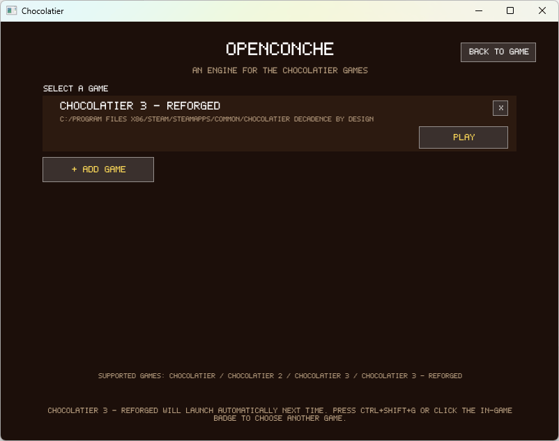
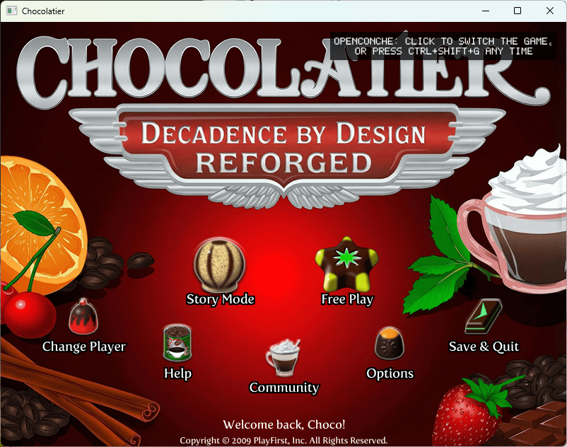
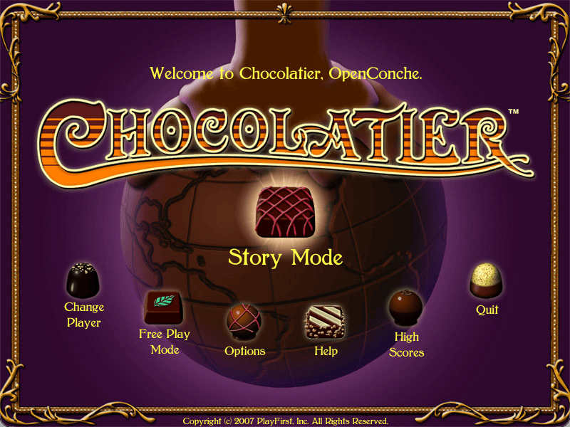
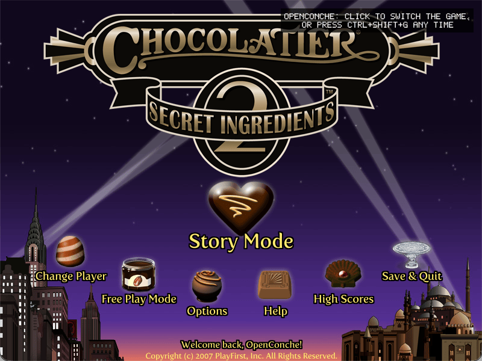
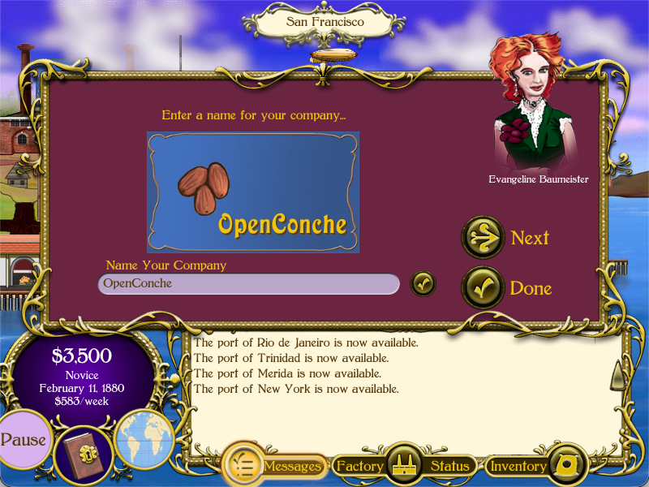
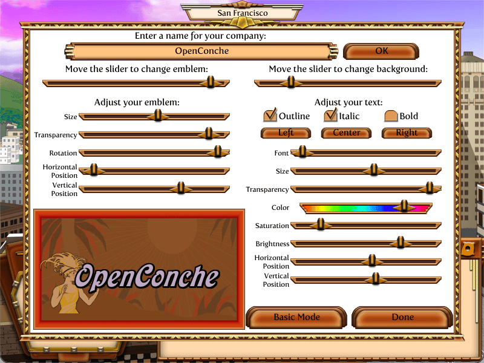
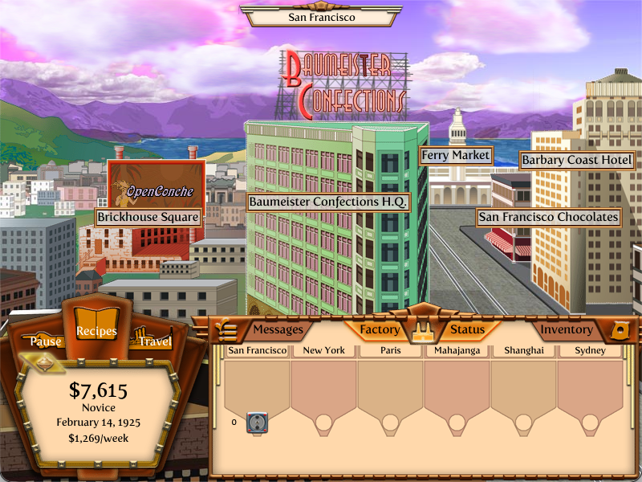
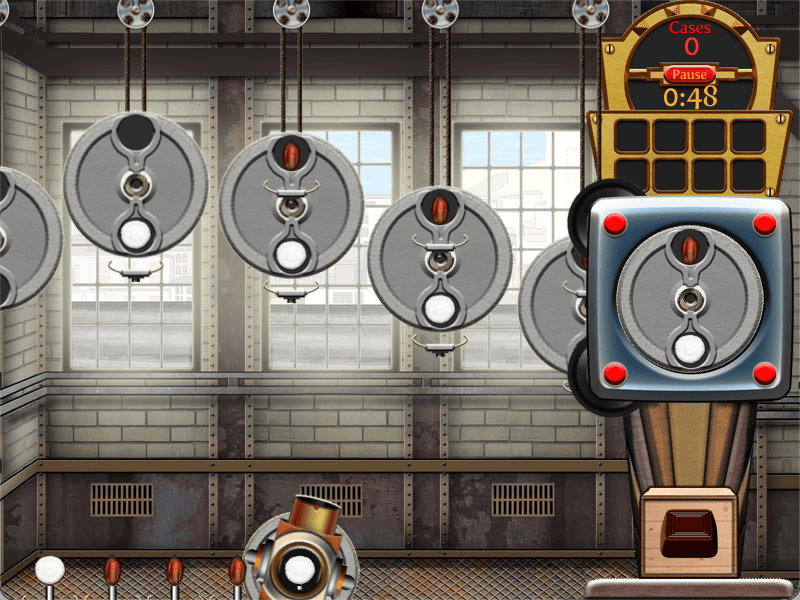
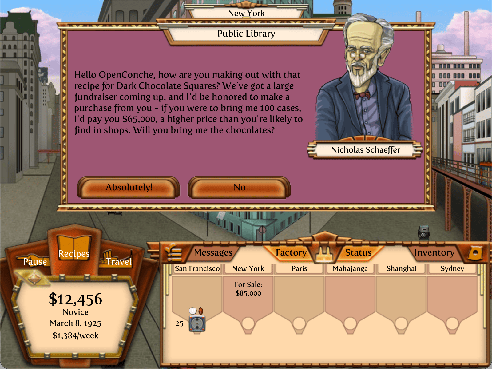

# OpenConche — a new engine for the Chocolatier games

A modern, open source, cross-platform engine for running Chocolatier,
Chocolatier 2: Secret Ingredients, Chocolatier: Decadence by Design.

## Why?

Between 2007 and 2009, Big Splash Games released Chocolatier and Chocolatier 2:
Secret Ingredients (published by PlayFirst), and Chocolatier: Decadence by
Design. You can still buy Chocolatier: Decadence by Design on <a
href="https://store.steampowered.com/app/37210/Chocolatier_Decadence_by_Design/">Steam</a>.

However, the games are showing their age; on modern macOS you can't run them
anymore, and on Windows I had some issues with unsupported display drivers
and monitors, e.g. when using Steam streaming. When the game does run it
doesn't look the best, the game is rendered at 800x600 resolution and then
optionally scaled to fullscreen.

This project allows you to run all three games on modern platforms, and renders
natively at any resolution. The game art is only available for the 800x600
resolution so is still scaled up, but the text renders at your native size,
much improving the overall look.

OpenConche is just the new engine, you still need the original game assets in
order to play.

  
  

## What?

Two things live in this repository:

1. The engine: a new, from-scratch cross-platform engine in C++20 and SDL3,
   built to run the original games.
2. `docs/` — the reverse-engineering record: every engine decision is cited to
   the fact files in `docs/re/`, and the design docs in `docs/design/` record
   how and why each subsystem was read, reasoned and built. Honestly, don't
   bother reading them, it's just for the AI agents.

### What to expect

This is a hobby project, published as-is. It was built in a few weeks of
AI-driven development against the games' own binaries and scripts, with the
reverse-engineering record kept alongside the code so that the reasoning behind
every decision is checkable. It is released so that it exists somewhere public:

- **Do with it what you want.** Fork it, build on it, port it, strip it for parts. The engine code is MIT.
- **Do not expect updates.** There is no roadmap, no issue triage and no promise of replies.
- **Releases**: prebuilt Windows, Linux and macOS binaries can be found on the Releases page. That is all that is planned.

## Screenshots

  
  

  
  

  
  

The fonts render at the real window resolution, here at 2x, while the art stays 800x600:

  

## Requirements

- Your own copies of the games. The engine finds the assets in your installs (Windows `assets/`, the Mac
  `Contents/Resources/assets/`, or one level down) or takes an explicit `--assets` path.

## Play

Download a build from the Releases page (or build it yourself: see
[BUILDING.md](BUILDING.md)) and launch the executable.

Running `openconche` without `--assets` first shows the **game finder**: a
launcher screen rendered by the engine itself, where you can start any of the
games you've added. Click **Add game** and pick the game's install folder in the
OS folder dialog, and the engine does the rest. Added games are remembered in
the engine's own config, `OpenConche/games.cfg` under your user folder
(%APPDATA%, `~/.local/share`, `~/Library/Application Support`), and the last one
you played starts automatically next time. **In game, Ctrl+Shift+G** (or
clicking the OpenConche badge that shows up on launch for a short while) opens
the finder again to switch games.

On macOS the app is not signed with an Apple developer certificate, so after
downloading, macOS will say it is "damaged" or "cannot be opened". Clear the
quarantine flag once, in Terminal, from the folder you unzipped it to:

    xattr -dr com.apple.quarantine OpenConche.app

Then double-click `OpenConche.app`.

On Linux, the folder dialog needs the desktop portal or `zenity` (Ubuntu:
`sudo apt install zenity`).

Each game keeps its own players and saves, separate from the original game's.
Chocolatier 3 and Chocolatier 3 Reforged have different content, so a player
created in one won't appear in the other.

---

## Questions

- **Will it run other PlayFirst games?** It could, but I’m not going to add
  support myself. The three Chocolatier games are the only targets, and nothing
  else is planned.

  The engine implements the parts of the Playground SDK used by those three
  games, so it could provide a good starting point for porting another game built
  on the same SDK (e.g. Diner Dash 2 or Dream Chronicles). However, this doesn’t
  mean those games will work out of the box. You’d still need to implement the
  game-specific code, and potentially extend the engine with SDK functionality
  that Chocolatier doesn’t use. The per-game modules in `src/games/` are where that
  work would go (see `docs/design/engine-and-games.md`). You’ll have to fork the
  project and bring your own AI agent :)
- **What is a conche?**
  <i>a machine in which chocolate is worked in the preparation of fine grades</i>

---

## Credits, license and permissions

- *Chocolatier*, *Chocolatier 2: Secret Ingredients* and *Chocolatier 3:
  Decadence by Design* were created by **Big Splash Games** and published by
  **PlayFirst**. All original material belongs to its rights holders; this
  project doesn't distribute any of it.
- The engine's own code is released under the **MIT license** (`LICENSE`). The
  two third-party files, `stb_image.h` and `stb_vorbis.c`, are public domain.
- [Chocolatier: Decadence by Design
  Reforged](https://github.com/GameBoy2936/Chocolatier-Decadence-Reforged) is
  Michael Lane's work and a great effort adding new life to the game!

---

*This is a fan project. It is not affiliated with, or endorsed by, PlayFirst or Big Splash Games.*
